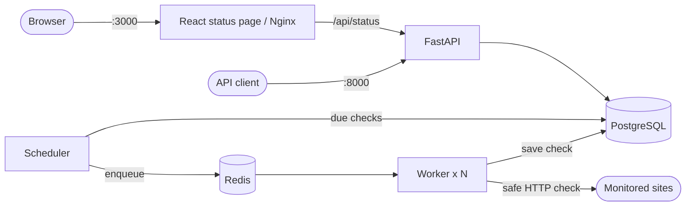

# Uptime Monitor

A self-hosted website monitoring project built with FastAPI, PostgreSQL, Redis, and React. It includes a monitor management API, a background check queue, incident and webhook support modules, and a read-only public status page. This is a learning project and is not intended as a production monitoring service.

## Features

- Create, list, inspect, and delete monitors through the REST API.
- Check HTTP and HTTPS URLs on configurable intervals from 30 seconds to 1 hour.
- Record each check's status, HTTP status code, response time, error, and timestamp.
- Protect URL checks from requests to private, loopback, and cloud metadata addresses. Checks time out after five seconds and do not follow redirects or read response bodies.
- Queue checks in Redis and run them in independently scalable worker containers.
- Provide a cached, read-only status document and a React page that polls it every 30 seconds.
- Calculate 24-hour uptime and include current monitor states and open incidents in the status document.
- Include incident evaluation and webhook delivery/retry modules, with unit tests.

> **Implementation note:** Incident evaluation and webhook delivery are implemented as backend modules, but the current worker does not yet call them after saving a check. Automatic incident creation/resolution and webhook delivery are therefore not active in the Compose workflow yet.

## Architecture



The API, scheduler, and worker use the same backend image with different start commands. The scheduler polls every five seconds and uses Redis keys to avoid enqueueing the same monitor repeatedly. Workers consume jobs from a Redis list. The frontend's Nginx proxy exposes only `GET /api/status`; monitor management remains available directly through the API on port 8000.

## Quick start

Requirements: Docker with the Compose plugin, Git, and OpenSSL.

```bash
git clone https://github.com/alvinl33-1/uptime-monitor.git
cd uptime-monitor

# Create a local database password for Compose.
printf 'POSTGRES_PASSWORD=%s\n' "$(openssl rand -hex 16)" > .env

docker compose up -d --build
docker compose ps
```

Open the public status page at <http://127.0.0.1:3000> and the interactive API documentation at <http://127.0.0.1:8000/docs>.

Create a monitor in `/docs` with `POST /monitors`:

```json
{
  "name": "Example",
  "url": "https://example.com",
  "interval_seconds": 60
}
```

The interval must be between 30 and 3600 seconds. The scheduler will enqueue its first check on a subsequent pass. Follow service output with:

```bash
docker compose logs -f scheduler worker
```

## Services and ports

| Service | Purpose | Host access |
|---|---|---|
| `frontend` | React status page served by Nginx | `http://127.0.0.1:3000` |
| `api` | FastAPI monitor, check, incident, health, and status endpoints | `http://127.0.0.1:8000` |
| `scheduler` | Finds monitors due for a check and enqueues jobs | Internal |
| `worker` | Checks target URLs and saves results | Internal; can be scaled |
| `db` | PostgreSQL 17 data store | Internal |
| `redis` | Job queue and status cache | Internal |
| `webhook-receiver` | Development-only webhook test receiver | Dev profile only |

Scale workers with:

```bash
docker compose up -d --scale worker=3
docker compose logs -f worker
```

Stop the services while keeping database data, or remove the database volume too:

```bash
docker compose down
docker compose down -v
```

## Configuration

Compose reads these values from the project `.env` file or the shell environment:

| Variable | Default / requirement | Purpose |
|---|---|---|
| `POSTGRES_PASSWORD` | Required | Password for the Compose PostgreSQL user. |
| `ALERT_WEBHOOK_URL` | Empty | Webhook destination used by the alert module when alert delivery is connected to the check flow. |
| `ALERT_ALLOW_PRIVATE` | `false` | Allows private webhook destinations when set to `true`; intended for local development. |

The backend also reads `DATABASE_URL` and `REDIS_URL`, which Compose sets for its services. The status cache reads `STATUS_CACHE_SECONDS` (default 15 seconds); it can be set in the backend service environment if needed. Do not commit `.env` or real webhook credentials.

## API overview

Interactive schemas and examples are available at `/docs`.

| Method | Path | Description |
|---|---|---|
| `GET` | `/health` | API process health |
| `GET` | `/health/db` | Database connectivity |
| `GET` | `/status` | Cached public status document; does not expose monitor URLs |
| `POST` | `/monitors` | Create a monitor |
| `GET` | `/monitors` | List monitors |
| `GET` | `/monitors/{id}` | Get one monitor |
| `DELETE` | `/monitors/{id}` | Delete a monitor and its checks and incidents |
| `POST` | `/monitors/{id}/check` | Run and save a check immediately |
| `GET` | `/monitors/{id}/checks` | List recent checks (`limit` 1–100) |
| `GET` | `/incidents` | List incidents (`open_only`, `limit`) |
| `GET` | `/monitors/{id}/incidents` | List incidents for one monitor |

The public status document contains the overall state, per-monitor state, 24-hour uptime, latest response time and check time, and currently open incidents. The current frontend displays the overall state and monitor/incident counts, and requests data through its same-origin `/api/status` route. The Nginx configuration returns 404 for other `/api/` paths.

## Development and tests

Backend tests use SQLite and fake Redis, so they do not need the Compose database or Redis services:

```bash
docker compose build api
docker compose run --rm --no-deps api pytest
```

Frontend development and checks:

```bash
cd frontend
npm ci
npm run dev
npm test
npm run build
npm run lint
```

The development webhook receiver can be started with the `dev` Compose profile. The receiver listens on port 9000 inside the Compose network and prints received payloads. It can be made to return HTTP 500 by creating `/tmp/fail` inside its container.

## Data model

- **Monitors:** name, URL, check interval, and creation time.
- **Checks:** monitor, `up`/`down` status, status code, response time, error, and check time.
- **Incidents:** monitor, start and resolution times, and alert-delivery timestamps.

Tables are created at API startup; schema migrations are not configured yet. PostgreSQL data is stored in the `db-data` named volume. Redis has no persistent volume, so queued jobs and cached status are lost when Redis is recreated.

## Current limitations

- The worker currently saves check results but does not invoke incident evaluation or webhook delivery. Those modules are implemented and tested separately.
- A job can be lost if a worker stops after taking it from Redis; the next scheduled check eventually covers the gap.
- DNS rebinding is not fully prevented because the connection is not pinned to the validated IP address.
- The API has no authentication or rate limiting and should not be exposed publicly without additional protections.
- TLS, production secrets management, database backups, and schema migrations are not configured.

## Roadmap

- [x] PostgreSQL, Docker Compose, monitor API, and automated tests
- [x] Safe URL checker and Redis-backed scheduler/worker queue
- [x] Status API, Redis caching, and React status page
- [x] Incident rules and webhook alert/retry modules (integration into the worker flow remains)
- [ ] Connect incident evaluation and webhook retries to check processing
- [ ] CI with GitHub Actions
- [ ] Cloud deployment with Terraform
- [ ] Kubernetes deployment and observability
- [ ] Production hardening: TLS, authentication, secrets, backups, and rate limiting

## Tech stack

Python 3.14, FastAPI, SQLAlchemy, PostgreSQL 17, Redis 7, httpx, pytest, React 19, TypeScript, Vite, Vitest, Nginx, Docker, and Docker Compose.
