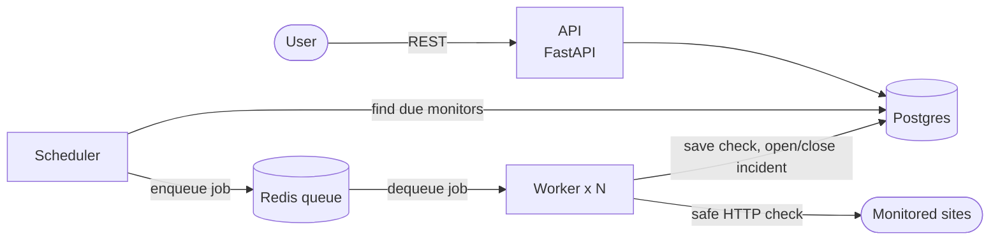

# Uptime Monitor

A small, self-hosted service that watches websites for you. Register a URL and it checks the site on a schedule, records whether it responded and how fast, and opens an **incident** when the site fails several checks in a row.

Built as a hands-on project to learn microservices, queues, and DevOps fundamentals (Docker, CI/CD, cloud, Kubernetes). It is a learning project, not a production monitoring product.

## Features

- Add, list, and delete monitors through a REST API
- Automatic checks on a per-monitor interval (30 seconds to 1 hour)
- Records status, HTTP status code, response time, and error for every check
- Opens an incident after 3 consecutive failures and resolves it on the first success
- Scheduler and workers run as separate services, so workers scale independently
- SSRF protection: the checker refuses private, loopback, and cloud-metadata addresses
- Health endpoints for the API, database, and Redis
- Runs entirely with Docker Compose, with automated tests that need no external services

## Architecture



**How a check happens**

1. You create a monitor through the API.
2. Every 5 seconds the scheduler finds monitors that are due (never checked, or last checked at least `interval_seconds` ago) and pushes a job onto a Redis queue.
3. A worker takes the job, runs the checker against the site, and saves the result to Postgres.
4. The worker then evaluates incident rules: three failures in a row open an incident, and one success closes it.

### Services

| Service | Role |
|---|---|
| `api` | FastAPI server for managing monitors and reading results |
| `scheduler` | Finds due monitors and enqueues check jobs |
| `worker` | Runs checks and saves results; scale with `--scale worker=N` |
| `db` | PostgreSQL 17 with a named volume |
| `redis` | Job queue and scheduling guard keys |


The API, scheduler, and worker share one codebase and one Docker image. Only the start command differs.

### Data model

- **monitors**: name, URL, check interval
- **checks**: monitor, status (`up`/`down`), status code, response time, error, timestamp
- **incidents**: monitor, start time, resolve time (an empty `resolved_at` means the incident is open)

## Quick start

You need Docker (with Docker Compose) and git.

```bash
git clone https://github.com/alvinl33-1/uptime-monitor.git
cd uptime-monitor

# Create your private settings file with a random database password
echo "POSTGRES_PASSWORD=$(openssl rand -hex 16)" > .env

docker compose up -d --build
docker compose ps
```

Wait until the services report `healthy`, then open the interactive API docs at **http://127.0.0.1:8000/docs**.

1. In `/docs`, use **POST /monitors** to add `{"name": "Example", "url": "https://example.com", "interval_seconds": 30}`.
2. Watch it work: `docker compose logs -f scheduler worker`
3. See results at `GET /monitors/1/checks`.
4. Add a monitor pointing at `http://localhost:8000` (always blocked, so always "down") and watch an incident open after three failures at `GET /incidents?open_only=true`.

### Scale the workers

```bash
docker compose up -d --scale worker=3
docker compose logs -f worker
```

Each log line is prefixed with the worker that handled it. Redis hands each job to exactly one worker.

### Stop everything

```bash
docker compose down        # keeps your data
docker compose down -v     # also deletes the database volume
```

## API overview

| Method | Path | Description |
|---|---|---|
| GET | `/health` | API is running |
| GET | `/health/db` | API can reach Postgres |
| GET | `/health/redis` | API can reach Redis |
| POST | `/monitors` | Create a monitor |
| GET | `/monitors` | List monitors |
| GET | `/monitors/{id}` | Get one monitor |
| DELETE | `/monitors/{id}` | Delete a monitor and its history |
| POST | `/monitors/{id}/check` | Run a check now and save the result |
| GET | `/monitors/{id}/checks` | Recent checks, newest first (`limit` 1 to 100) |
| GET | `/incidents` | All incidents, newest first (`open_only`, `limit`) |
| GET | `/monitors/{id}/incidents` | Incidents for one monitor |

Full request and response schemas are available in the interactive docs at `/docs`.

## Running the tests

Tests run inside Docker against a throwaway in-memory database and a fake Redis, so they are fast and never touch real data.

```bash
docker compose build api
docker compose run --rm --no-deps api pytest
```

They cover the API, the checker (including the safety rules), the queue, the scheduler, the worker, and the incident logic.

## Design decisions

- **SSRF protection.** A service that visits user-supplied URLs can be tricked into reaching internal systems. Before every request the checker resolves the hostname and refuses the check unless every resolved address is public. It also uses a 5-second timeout, does not follow redirects, and never reads response bodies.
- **No duplicate scheduling.** The scheduler sets a Redis key per monitor with `SET NX EX`. Only the first caller succeeds, and the key expires on its own, so a lost job heals itself after one interval.
- **One open incident per monitor, enforced by the database.** A partial unique index on `incidents` (where `resolved_at IS NULL`) means a race between workers cannot create duplicates.
- **Bad input cannot crash a worker.** Malformed queue messages are discarded, and exceptions inside the worker loop are logged and retried after a short pause.
- **Graceful shutdown.** The scheduler and worker handle `SIGTERM`, which is how Kubernetes stops containers.
- **Config from the environment.** All settings come from environment variables, and secrets stay out of git (`.env` is ignored; `.env.example` holds placeholders only).

## Known limitations

- A job is lost if a worker dies immediately after taking it from the queue. The next scheduled check covers the gap. A "processing" list would make delivery at-least-once.
- DNS rebinding is not fully blocked. Closing the gap means connecting directly to the validated IP address.
- Tables are created at startup rather than through migrations.
- Redis has no persistent volume, so a Redis restart empties the queue.
- There is no authentication yet.

## Roadmap

- [x] Project setup, Postgres, Docker Compose
- [x] Monitors API with validation and tests
- [x] Safe website checker with SSRF protection
- [x] Redis queue, scheduler, and scalable workers
- [x] Incidents (open after 3 failures, resolve on recovery)
- [ ] Webhook alerts, sent exactly once per incident event
- [ ] Frontend: dashboard and public status page with Redis caching
- [ ] CI with GitHub Actions
- [ ] Cloud deployment with Terraform
- [ ] Kubernetes deployment (one Deployment per service)
- [ ] Observability with Prometheus and Grafana
- [ ] Hardening: TLS, secrets management, backups, rate limiting


## Tech stack

Python, FastAPI, SQLAlchemy, PostgreSQL, Redis, httpx, pytest, Docker, Docker Compose.
